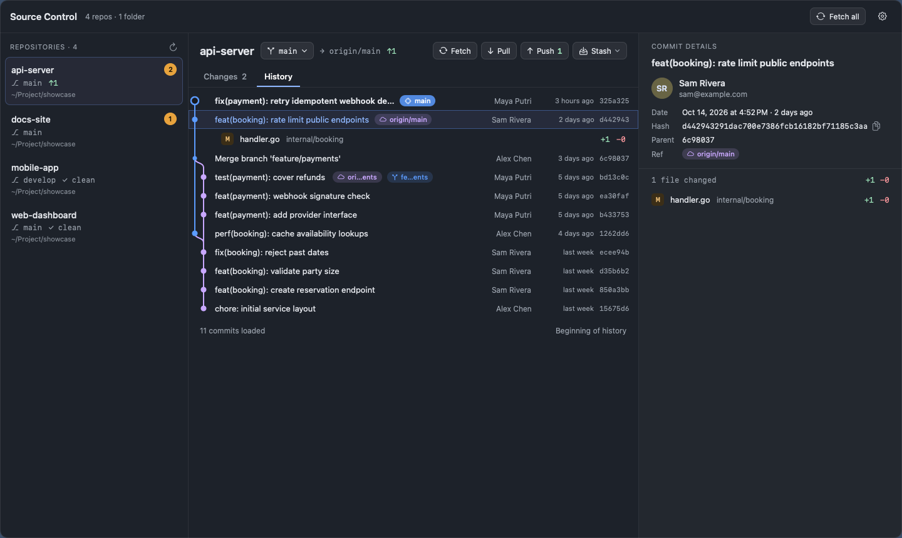

# Git AppBar

A macOS menu bar app for working with many git repositories at once — like
VS Code's Source Control panel, but for every repo on your machine and one
click away from the menu bar.



## Features

- **All your repos in one place** — pick one or more folders; every git
  repository inside is found automatically (configurable depth, skips
  `node_modules`, `vendor`, build folders…). Each repo shows its branch,
  changed files and ahead/behind counts.
- **History with a commit graph** — branches, merges, HEAD and branch / remote /
  tag pills, author and time for every commit, incoming upstream commits
  included. Paginated (100 commits per page).
- **Commit details** — full message, author, email, date, hash, parents and the
  changed files with `+`/`−` counts.
- **Commit** the files you pick (all checked by default), **Commit & Push**,
  **Fetch**, **Fetch all repos**, **Pull**, **Push**, **Stash** (save / apply /
  pop) and **switch branch** (local or remote, with search).
- **Open files in your editor** — VS Code by default, any CLI works
  (`cursor -g`, `zed`, `subl`, `open -a Xcode`…), with an optional confirmation.
- **Transparent full-width panel** with adjustable opacity and blur.
- **English and Bahasa Indonesia**, switchable live in Preferences.

## Safe by design

The panel is meant for everyday git, not for surgery. It deliberately does not
do anything that can lose work:

- Pull is fast-forward only (`git pull --ff-only`) — it never merges or rebases
  behind your back; a diverged branch is reported, your commits are untouched.
- Push is never forced and is blocked while the remote has commits you
  haven't pulled.
- Switching branch with uncommitted changes asks first: stash, or bring the
  changes along.
- A stash that conflicts on pop stays in the list.
- No `reset --hard`, `clean`, stash drop or force push.
- Network operations time out after 120 s and SSH runs in batch mode, so a
  missing key or unreachable remote fails with a message instead of hanging.

Everything is read from and done with your local `git` — no GitHub account or
API token involved.

## Install

Requirements: macOS 14+, Xcode / Swift 6 toolchain, `git` at `/usr/bin/git`.

```bash
git clone https://github.com/rtoedz/git-appbar.git
cd git-appbar
./make_app.sh                       # builds GitAppBar.app
cp -R GitAppBar.app ~/Applications/
open ~/Applications/GitAppBar.app
```

Click the branch icon in the menu bar, choose the folder(s) that contain your
projects, and you're set. `Esc` or a click outside closes the panel.

The app is ad-hoc signed and not sandboxed (it needs to run `git` in your
folders), so it is not distributed through the App Store.

## Development

```bash
swift run                          # run without building the bundle
GAB_OPEN_ON_LAUNCH=1 swift run     # open the panel on launch
swift test                         # parser, scanner and git-action tests
```

`GitAppBarCore` (models, git runner, parsers) has no UI dependencies and is
covered by tests that run real git commands against temporary repositories and
a local bare remote. `GitAppBar` is the SwiftUI/AppKit app.

Debug switches used to verify the UI without clicking through it:

| Variable | Effect |
|---|---|
| `GAB_RENDER=out.png` | Render the panel to a PNG and quit (`GAB_ROOTS`, `GAB_RENDER_REPO`, `GAB_RENDER_WIDTH`, `GAB_LANG`, `GAB_RENDER_TAB`) |
| `GAB_ACTION_TEST=/tmp/dir` | Drive commit / push / fetch / pull / stash end to end against a throwaway remote |
| `GAB_STRESS=1` | Switch repositories rapidly in an offscreen window to catch UI races |
| `GAB_ESC_TEST=1` | Check that `Esc` closes dialogs and the panel |
| `GAB_PICKER_TEST=1` | Check that the folder chooser opens in front of the panel |

`scripts/make_showcase.sh` regenerates `docs/screenshot.png` from fictional
demo repositories.

## License

MIT
